# LVGL 9.3 → 9.6 migration

How the Ambiq LVGL port moved from LVGL **9.3.0** to **9.6**, one upstream
release at a time, and what each step changed on the Ambiq side. Every step was
built, flashed and captured on the **Apollo510 EVB** with the four demos in
`lvgl_ambiq_demo/` before the next one started.

| repo | branch | start | end |
|---|---|---|---|
| `AmbiqMicro/LVGL` (submodule `LVGL/`) | `feat-lvgl-v9.6` | `ambiq-stable` @ `fcb05b7` (v9.3.0 + 69 Ambiq commits) | `48f81fcad` |
| `AmbiqMicro/lv_port_ambiq` | `feat-v9.6` | `main-v9.3` | `d2eb5ae` |

The upgrade is a series of merges of upstream's `release/v9.x` branches into
`feat-lvgl-v9.6`, each followed by the Ambiq fixes it needed. Merging rather than
rebasing keeps Ambiq's 69 commits intact and makes each version step a single,
reviewable merge commit.

---

## Summary

| step | LVGL commits | lv_port commit | what broke for Ambiq |
|---|---|---|---|
| [9.3 → 9.4](#93--94) | `dfcb064c6` merge, `ab5dad4e7` fix | `855f19a` | vector/draw-task API renames; Ambiq's VGLite changes dropped; upstream adopted the font stride fix and a `buf_copy_cb` |
| [9.4 → 9.5](#94--95) | `b63f34da0` merge, `f800967d8` fix | `88414b1` | font and mask headers moved; new font/snapshot source dirs; sysmon moved |
| [9.5 vector font](#95-vector-font) | `9f6541972` merge | (with 9.6) | FreeType outline **border pass removed** |
| [9.5 → 9.6](#95--96) | `ad17e6d08` merge, `5ab8d103e`, `e2dc15670`, `48f81fcad` | `8d2406b`, `d2eb5ae` | public headers moved to `include/`; config **generated from Kconfig**; upstream `buf_clear_cb`; ~30 source dirs moved |

### Results

Readings are from LVGL's on-screen sysmon overlay in a single captured frame
(top: heap used / max, bottom: FPS, CPU, render ms), so treat them as spot
checks, not benchmarks.

| demo | 9.3 | 9.4 | 9.5 | 9.6 | 9.6 clean |
|---|---|---|---|---|---|
| `lvgl_test` (music) | 62 FPS · 3% · 30.8 kB | 62 FPS · 3% · 30.9 kB | 62 FPS · 4% · 31.7 kB | 62 FPS · 3% · 32.3 kB | 62 FPS · 3% · 32.3 kB |
| `lvgl_cellular_menu` | 55 FPS · 57% · 11.1 kB ¹ | 53 FPS · 70% · 11.2 kB ¹ | 59 FPS · 43% · 11.4 kB | 62 FPS · 35% · 11.5 kB | 62 FPS · 34% · 11.5 kB |
| `lvgl_ttf` (CJK scroll) | 62 FPS · 40% · 210.3 kB | 60 FPS · 36% · 210.8 kB | 62 FPS · 32% · 211.5 kB | 62 FPS · 23% · 211.4 kB | 60 FPS · 22% · 211.3 kB |
| `lvgl_smartwatch` | — ² | 62 FPS · 8% · 71.1 kB | 62 FPS · 8% · 72.6 kB | 62 FPS · 8% · 73.9 kB | 62 FPS · 8% · 73.9 kB |

¹ Captured during the icon fly-in animation, not the settled grid (compare the
images), so these frames are heavier and not comparable with the later columns.
² The 9.3 smartwatch capture was taken before the wallpapers finished loading
from eMMC and shows an undecoded buffer.

Binary size, 9.5 → 9.6: `lvgl_test` 1 252 044 → 1 246 620 B, `lvgl_ttf`
542 668 → 539 932 B, `lvgl_smartwatch` 2 338 520 → 2 331 336 B,
`lvgl_cellular_menu` 1 844 068 → 1 839 044 B. The 9.6 → 9.6-clean step changed
no code: all four binaries are byte-identical in size.

The `lvgl_ttf` CPU drop (40% → 22%) is consistent across the last three
columns but comes from one frame of a scrolling demo; confirm with the LVGL
benchmark before quoting it.

### Captures

`captures/<version>/<demo>.png`, 464×464, read back from the frame buffer over
J-Link. `v9.6` is the first build that ran on 9.6; `v9.6-clean` is the same code
after the warning cleanup.

| | 9.3 | 9.4 | 9.5 | 9.6 | 9.6 clean |
|---|---|---|---|---|---|
| `lvgl_test` | 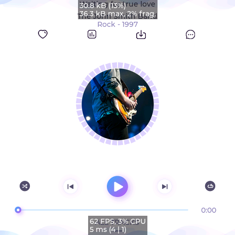 | 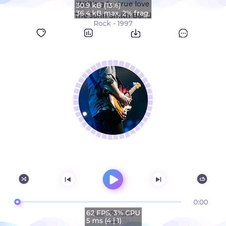 | 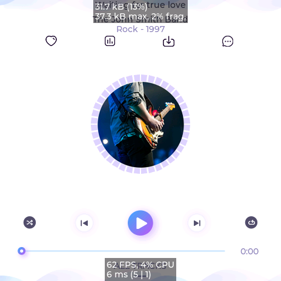 |  |  |
| `lvgl_cellular_menu` | 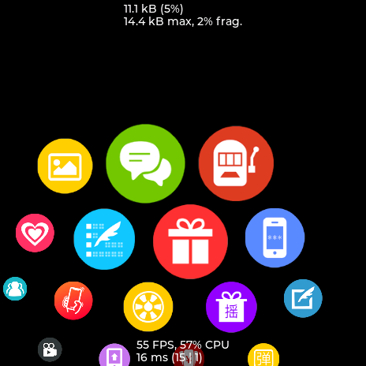 | 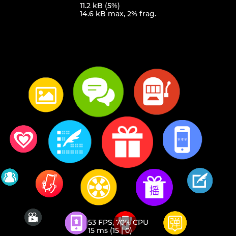 | 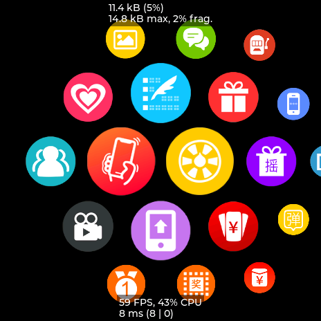 |  |  |
| `lvgl_ttf` | 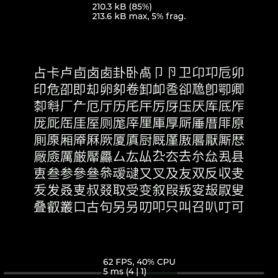 | 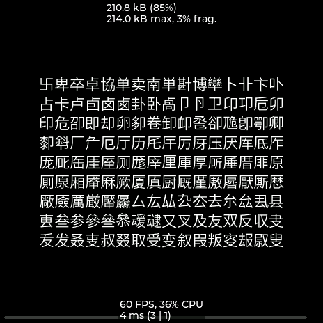 | 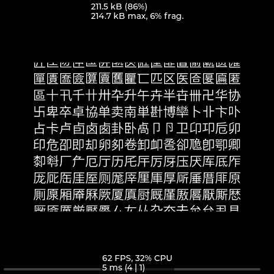 | 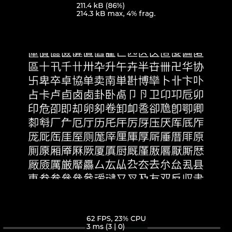 | 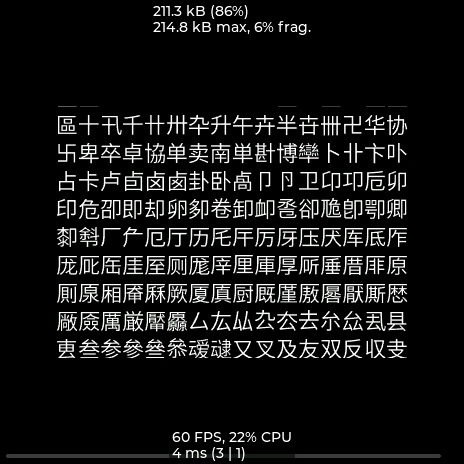 |
| `lvgl_smartwatch` | 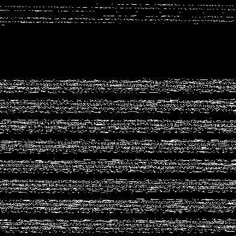 |  | 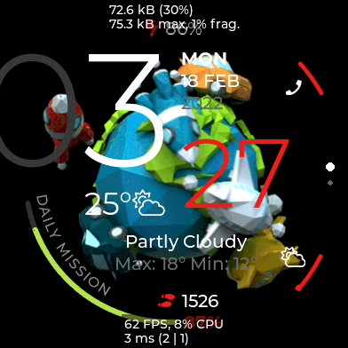 | 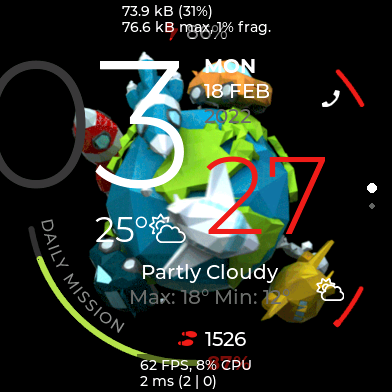 | 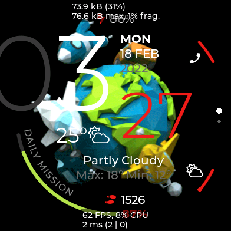 |

`lvgl_ttf` scrolls continuously, so its text position differs between captures;
`lvgl_smartwatch` animates its planet and satellites. Everything else is static
and matches across versions.

---

## 9.3 → 9.4

**LVGL** — merge `upstream/release/v9.4` (`dfcb064c6`), then
`ab5dad4e7 fix(ambiq): adapt the draw unit to the LVGL 9.4 APIs`.

Conflicts and how they were resolved:

- **VGLite**: Ambiq's VGLite-related changes conflicted and were dropped in
  favour of upstream; the Ambiq port does not use VGLite.
- **Draw buffer copy**: 9.4 added `buf_copy_cb` to the draw-buffer handlers,
  doing what an Ambiq core patch did. Upstream's hook was taken and
  `lv_draw_ambiq_buffer.c` registers `.buf_copy_cb`. Ambiq's separate
  **`clear_cb`** (`lv_draw_buf_clear_cb_t`) had no upstream equivalent yet and
  was kept.
- **Font stride fix**: upstream merged the same fix Ambiq had carried; upstream's
  version was taken.
- **`lv_conf_template.h` / `Kconfig`**: Ambiq's `LV_USE_DRAW_AMBIQ` block kept.
- **`lv_conf_internal.h`**: regenerated with `scripts/lv_conf_internal_gen.py`
  instead of hand-merged.

Ambiq code adapted to 9.4 renames:

- `lv_vector_draw_dsc_t` → `lv_vector_path_ctx_t`
- `lv_draw_vector_task_dsc_t` → `lv_draw_vector_dsc_t`
- `LV_DRAW_TASK_STATE_READY` → `LV_DRAW_TASK_STATE_FINISHED`
- `lv_draw_vector.c`: `(LV_USE_DRAW_AMBIQ && LV_USE_AMBIQ_VG)` added to the
  backends that satisfy `LV_USE_VECTOR_GRAPHIC`.

**lv_port** — `9c1a9c0` points the submodule at `feat-lvgl-v9.6`
(`.gitmodules` branch updated); `855f19a` moves to 9.4 and adds
`src/draw/convert/*.c` to `common.mk`.

## 9.4 → 9.5

**LVGL** — merge `upstream/release/v9.5` (`b63f34da0`), then
`f800967d8 fix(ambiq): follow headers moved in LVGL 9.5`.

Conflicts:

- `.github/CODEOWNERS`, `build_micropython.yml`: Ambiq's (owners; disabled
  artifact upload). `compile_docs.yml`: upstream's action bump.
- `Kconfig`: both blocks.
- `lv_draw_vector.c`: upstream added NanoVG to the vector-backend check; Ambiq
  kept alongside it, in the condition and the `#error` text.
- `lv_init.c`: Ambiq's draw-unit deinit plus upstream's Wayland deinit.
- Wayland (`lv_wayland_private.h`, `lv_wl_dmabuf.c`): upstream's refactor,
  including the file deletion.
- `lv_conf_internal.h`: regenerated (upstream + Ambiq's 59 lines).

Ambiq code:

- `lv_draw_ambiq_letter.c`: `font/lv_font_fmt_txt.h` →
  `font/fmt_txt/lv_font_fmt_txt.h`.
- `lv_draw_ambiq_mask_rect.c`: `lv_draw_mask_private.h` was removed and the
  rect-mask descriptor made public → include `lv_draw_mask.h`.

**lv_port** — `88414b1`: `common.mk` adds `src/draw/snapshot` and the split font
dirs (`fmt_txt`, `binfont_loader`, `imgfont`, `font_manager`); sysmon moved from
`src/others/` to `src/debugging/`. `lvgl_test/demo_common.mk` compiles
`demos/*.c`, which now holds `lv_demos.c` (`lv_demo_args_init`).

## 9.5 vector font

**LVGL** — merge `upstream/release/v9.5-vector-font` (`9f6541972`), one
conflict, in `lv_freetype_outline.c`.

The branch adds a generic font API callback and **removes FreeType's outline
border pass** (`border_width`, the `FT_Stroker` second iteration and
`LV_FREETYPE_OUTLINE_BORDER_START`). 9.6 has the same removal, so upstream's
shape was taken, keeping Ambiq's ordering of creating the outline after its
segment counts are known.

Consequence, handled in the 9.6 fix: **vector-font glyph outlines are no longer
stroked** (`outline_stroke_width` > 0 now draws only the fill).

## 9.5 → 9.6

The largest step. 9.6 restructured LVGL in two ways that reach past the
conflicted files.

**1. Public headers moved to `include/lvgl/`** (upstream `c329a2db3`). Every
old `src/**/X.h` public header is now a two-line stub that emits
`#warning Include public headers from the src folder is deprecated` and includes
`lvgl.h`. Git sees those as modifications, not renames, so an Ambiq edit to such
a header conflicts and has to be moved by hand to its `include/lvgl/` file.

**2. Config is generated from Kconfig** (upstream `a73e59f6d`).
`scripts/lv_conf_internal_gen.py` is gone. `scripts/generators/config_files.py`
reads the per-directory `Kconfig` files and generates the root `Kconfig`,
`lv_conf_template.h`, `include/lvgl/config/lv_conf_internal.h` and
`lv_conf_kconfig.h`; none of them is edited by hand any more. It needs
[kconfiglib](https://pypi.org/project/kconfiglib/) (14.1.0 was used).

**LVGL** — merge `upstream/release/v9.6` (`ad17e6d08`), 26 conflicts:

| resolution | files |
|---|---|
| upstream (no Ambiq delta; the same fixes reached both branches as backports) | `lv_draw_sw_letter.c`, `lv_draw_vg_lite_label.c`, `lv_font.c`, `lv_freetype.h`, `test_freetype.c`, 4 reference PNGs, both Wayland files, `lv_api_map_v8.h` |
| upstream (9.6 already creates the outline after counting, as Ambiq did) | `src/font/freetype/lv_freetype_outline.c` |
| deletion accepted (unused assets; Ambiq had only added `LV_ATTRIBUTE_LARGE_CONST`) | 3 × `examples/assets/img_cogwheel_*.c` |
| Ambiq's | `.github/CODEOWNERS`, `build_micropython.yml` |
| regenerated from the new `src/draw/ambiq/Kconfig` | `Kconfig`, `lv_conf_template.h`, `src/lv_conf_internal.h` (stub) |
| stub taken, Ambiq change moved to `include/lvgl/draw/lv_color.h` | `src/misc/lv_color.h` (`LV_COLOR_FORMAT_BGR888 = 0x19` and its 24-bit size) |
| both | `src/lv_init.c` (Ambiq init/deinit + 9.6's simplified PXP guard) |
| upstream hook, widened | `lv_draw_buf.c` / `.h` / `_private.h` (below) |

- **Ambiq Kconfig**: Ambiq's seven options moved, unchanged, into
  `src/draw/ambiq/Kconfig`, sourced from `src/draw/Kconfig` after NemaGFX.
  `LV_USE_AMBIQ_VG` selects `LV_DRAW_HAS_VECTOR_SUPPORT`, so vector support is
  derived like the other GPU backends. The generator also emits dependency
  checks; enabling `LV_USE_DRAW_AMBIQ` without `LV_USE_AMBIQ_VG` is now an
  `#error` (it was already a Kconfig `select`).
- **Clear hook**: 9.6 added `buf_clear_cb(draw_buf, area, layer)` and took the
  typedef name `lv_draw_buf_clear_cb_t` that Ambiq's two-argument `clear_cb` used.
  Upstream's hook was adopted. Upstream only calls it when a layer is passed;
  the Ambiq GPU clears without one, so `lv_draw_buf_clear_ex()` calls it when
  `layer != NULL || LV_USE_DRAW_AMBIQ`, keeping plain `lv_draw_buf_clear()` on
  the GPU.

Then three commits:

- `5ab8d103e fix(ambiq): adapt the draw unit to the LVGL 9.6 APIs`
  - `lv_draw_ambiq_buffer_clean` registered as `.buf_clear_cb` in the default,
    image-cache and font handler sets; takes and ignores `layer`.
  - `lv_draw_ambiq_vector_font.c`: the `BORDER_START` handling removed (see
    the vector-font step); FreeType included from `src/font/freetype/`.
  - `lv_image_decoder_private.h` moved from `src/draw/` to `src/image/`.
- `e2dc15670 fix(sysmon): allow the memory monitor with a custom allocator`
  - 9.6's `LV_USE_MEM_MONITOR` depends on `LV_USE_BUILTIN_MALLOC`, which the
    generator turns into an `#error`. The monitor only needs
    `lv_mem_monitor_core()`, which Ambiq's allocator
    (`lvgl_ambiq_porting/am_mem.c`) implements, and every demo uses
    `LV_STDLIB_CUSTOM` with the overlay on. The dependency is widened to
    `|| LV_USE_CUSTOM_MALLOC` and the config files regenerated. A candidate to
    propose upstream.
- `48f81fcad refactor(ambiq): include lvgl_public.h instead of deprecated src/ headers`
  - The draw unit included 22 public headers through the new stubs (350
    warnings per build). Each file now includes `../../lvgl_public.h` once,
    as upstream's draw units do.

**lv_port**

- `8d2406b build: LVGL 9.6 (moved source dirs)`: `common.mk` follows the sources
  9.6 moved, without which the demos compile but fail to link
  (`lv_log_add`, `lv_fs_open`, …):
  `bin_decoder`, `lv_lodepng.c`, `lv_image_decoder.c` → `src/image`;
  `fsdrv`, `lv_fs.c` → `src/fs`; `lv_log.c` → `src/logging`; profiler →
  `src/debugging/profiler`; GIF widget → `src/widgets/gif`; FreeType →
  `src/font/freetype`. The list stays per directory because objects are named
  by basename (`notdir` + `VPATH`), so globbing all of `src/` could collide.
- `d2eb5ae build: clear the LVGL 9.6 deprecation warnings`: the submodule bump
  above, plus in all four `lv_conf.h`:
  `LV_COLOR_DEPTH 16` → `LV_COLOR_FORMAT_DEFAULT LV_COLOR_FORMAT_RGB565` (9.6
  derives `LV_COLOR_DEPTH` = 16 from it, which `lv_ambiq_display.c` and the
  smartwatch's SquareLine check still read) and `LV_ASSERT_HANDLER_INCLUDE`
  removed; `am_mem.c` includes `lvgl.h`. A demo build went from ~1170 warnings
  to ~190, the ones the code already had before 9.6.

---

## Ambiq deltas still carried on top of upstream

What makes `feat-lvgl-v9.6` differ from `release/v9.6`, outside `src/draw/ambiq/`:

- `src/draw/ambiq/Kconfig` and its `rsource`, plus the generated config files.
- `lv_draw_buf.c`: `buf_clear_cb` also called without a layer when
  `LV_USE_DRAW_AMBIQ`.
- `include/lvgl/draw/lv_color.h`: `LV_COLOR_FORMAT_BGR888 = 0x19`.
- `lv_init.c`: `lv_draw_ambiq_init()` / `lv_draw_ambiq_deinit()`.
- `lv_draw_vector.c`: Ambiq in the vector-backend check.
- `src/debugging/sysmon/Kconfig`: memory monitor allowed with a custom allocator.
- `.github/CODEOWNERS`, `build_micropython.yml`.
- The closed `lvgl_ambiq_porting/gpu_patch/bin/lvgl_ambiq_porting.a` is unchanged
  and links against 9.6.

## Open items

- **Vector glyph outlines are not stroked** since the 9.5 vector-font merge.
  Restoring them means drawing a stroke from the glyph path in the Ambiq vector
  font path, or adopting upstream's new generic font callback.
- **`lvgl_ttf` uses deprecated calls**: `gui_task.c` calls
  `lv_obj_add_flag` / `lv_obj_has_flag` / `lv_obj_remove_flag`, which 9.6 logs
  at run time; move to `lv_obj_set_hidden()` and friends.
- **Performance**: the CPU numbers above are single-frame readings. Run
  `lv_demo_benchmark()` (select it in `lvgl_test/src/gui_task.c`, read over SWO)
  on 9.3 and 9.6 to confirm the `lvgl_ttf` and `lvgl_cellular_menu` gains.
- **Remaining ~190 warnings** per demo predate 9.6 (strict-prototypes,
  fall-through, redundant declarations).

## Reproducing

Build a demo (WSL, Arm GNU 13.2.Rel1 on `PATH`, AmbiqSuite 5.2.0). A clean build
is faster than an incremental one over `/mnt/c`:

```sh
cd lvgl_ambiq_demo/<demo>/apollo510_evb
rm -rf bin && make -j8 AMBIQSUITE_PATH=<ambiqsuite-5.2.0>
```

Regenerate the config after any `Kconfig` change:

```sh
cd LVGL
python3 -m pip install kconfiglib   # or put kconfiglib.py on PYTHONPATH
python3 scripts/generators/config_files.py
```

Flashing, logging (SWO for `lvgl_test`, `lvgl_cellular_menu`,
`lvgl_smartwatch`; UART for `lvgl_ttf`) and the frame-buffer captures were done
with a J-Link helper from a separate workspace; any J-Link flash of
`bin/<demo>.bin` to `0x00410000` reproduces the runs. Allow `lvgl_smartwatch`
~20 s to load its wallpapers from eMMC before capturing.
